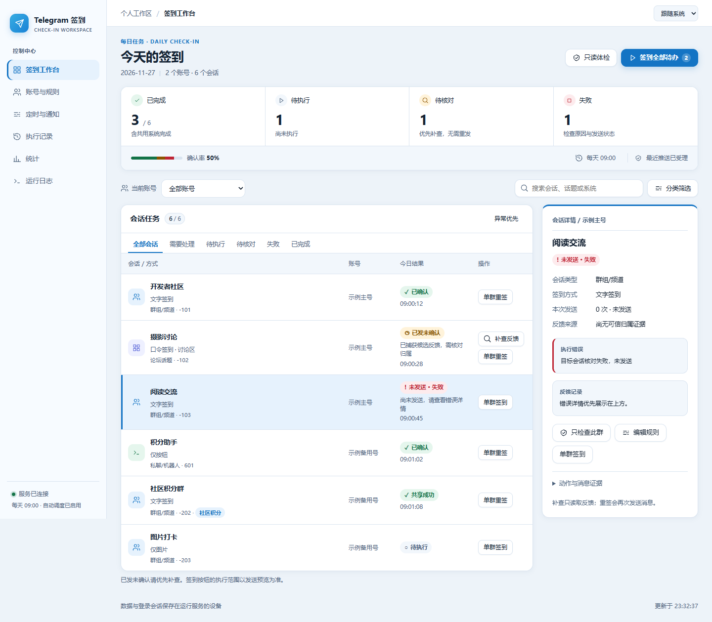
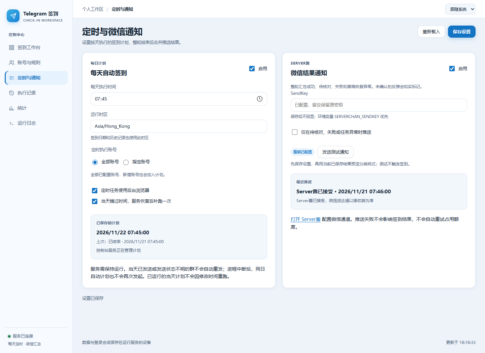
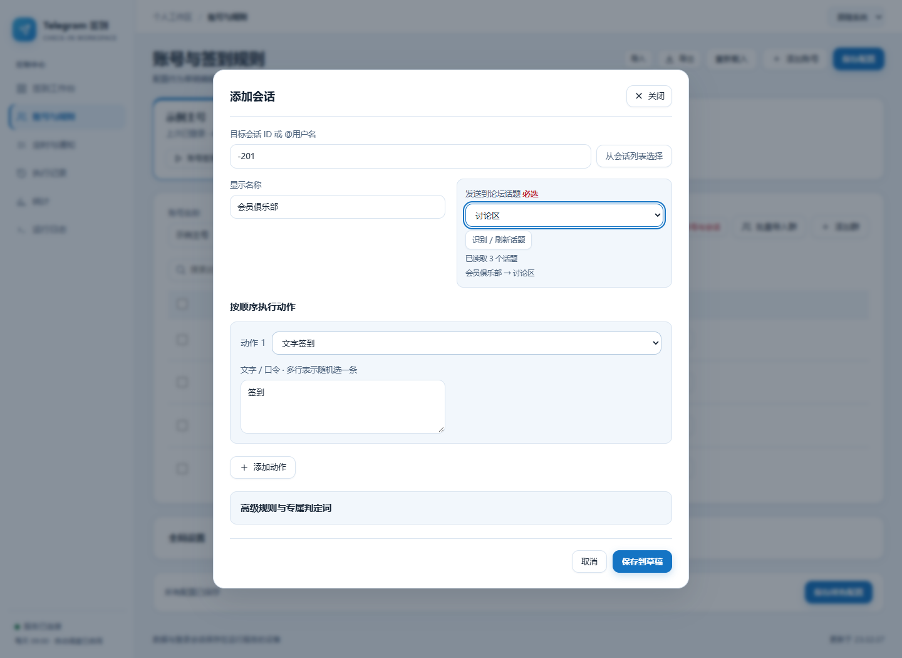

<div align="center">
  

  <h1>Telegram Checkin</h1>

  <p>
    <strong>简体中文</strong> · <a href="README_EN.md">English</a>
  </p>

  <p><strong>面向个人多账号的 Telegram Web 自动化签到工作台</strong></p>
  <p>无需申请 API ID / API Hash，支持桌面端与 Linux 云端常驻，内置每日定时调度、只读证据补查、草稿无损恢复与微信汇总推送。</p>

  <p>
    <a href="#下载安装"><strong>下载 v1.3.3</strong></a> ·
    <a href="#核心特性">核心特性</a> ·
    <a href="#界面预览">界面预览</a> ·
    <a href="#快速上手">快速上手</a> ·
    <a href="#结果与安全机制">安全机制</a> ·
    <a href="docs/CLOUD.md">云端部署</a> ·
    <a href="CHANGELOG.md">更新记录</a>
  </p>

  <p>
    <a href="https://github.com/ElmaTony/telegram-checkin/actions/workflows/build.yml"></a>
    
    
    <a href="LICENSE"></a>
  </p>

  <br>

  

  <p><sub>图示为匿名示例数据 · 支持 Telegram Sky 浅色 / 夜色双主题</sub></p>
</div>

---

## 核心特性

| 能力 | 说明 |
| --- | --- |
| **多账号与全类型会话** | 支持普通群组、只读频道、私聊机器人与**论坛话题（Forum Topics）**；添加会话时自动识别论坛话题并支持虚拟长列表滚动定位。 |
| **六种方式与多步串联** | 支持文字、口令、仅按钮、口令＋按钮、图片＋文字、仅图片及多步动作组合，支持随机文案、`{n}` / `X` 数字通配判定词，以及**共用系统主群优先与结果代签**。 |
| **证据驱动与防盲目重发** | 联合监测机器人回复、模态弹窗、非模态 Toast 与原按钮消息编辑，严格区分「成功 / 待确认 / 失败」；当天已发或状态不明的目标优先只读补查，不盲目重发。 |
| **云端草稿无损保护** | 进入会话前先备份并清空已有草稿，无论成功、失败或中途取消均恢复至原账号、原群与原话题；无法可靠恢复时保留本地备份并明确提示。 |
| **每日调度与微信汇总** | 内置独立于服务器系统时区的每日计划，提供自定义时间选择器、400+ 全量 IANA 时区检索、账号范围筛选、后台浏览器与错过补跑，整轮结束后经 **Server酱** 汇总推送微信。 |
| **现代双色工作台** | 内置 Telegram Sky 浅色与夜色主题，支持发送预览、实时执行进度、按日分组执行记录、统计面板与运行日志排查。 |

---

## 界面预览

### 定时计划与微信通知


<details>
<summary>展开查看：论坛话题选择弹窗</summary>

<br>



</details>

---

## 下载安装

### 方式一：独立发行包（推荐，免安装 Python）

前往 **[Latest Release](https://github.com/ElmaTony/telegram-checkin/releases/latest)** 下载对应系统的独立包，解压后保留完整目录结构（建议核对同名 `.sha256` 校验文件）：

| 操作系统与架构 | 下载文件 |
| --- | --- |
| Windows x64 | `telegram-checkin-v*-windows-x64.zip` |
| macOS Apple 芯片 | `telegram-checkin-v*-macos-arm64.tar.gz` |
| macOS Intel | `telegram-checkin-v*-macos-x64.tar.gz` |
| Linux x64 | `telegram-checkin-v*-linux-x64.tar.gz` |
| Linux ARM64 | `telegram-checkin-v*-linux-arm64.tar.gz` |

进入解压目录，首次安装 Chromium 浏览器后再启动工作台：

```powershell
# Windows (PowerShell)
.\telegram-checkin.exe --install-browser
.\telegram-checkin.exe
```

```bash
# macOS / Linux
./telegram-checkin --install-browser
./telegram-checkin
```

启动后在浏览器打开 **[http://127.0.0.1:8577](http://127.0.0.1:8577)**。

> [!NOTE]
> 运行设备需可访问 Telegram Web。Linux 如缺少浏览器系统依赖，请先执行 `sudo ./telegram-checkin --install-browser-deps`；macOS 独立包暂未经过 Apple 签名与公证，首次运行需在系统设置中允许打开。

### 方式二：从源码运行（Python 3.11+）

```bash
git clone https://github.com/ElmaTony/telegram-checkin.git
cd telegram-checkin
```

```powershell
# Windows (PowerShell)
python -m venv .venv
.\.venv\Scripts\python.exe -m pip install -r requirements.lock.txt
.\.venv\Scripts\python.exe -m playwright install chromium
.\.venv\Scripts\python.exe app.py
```

```bash
# macOS / Linux
python3 -m venv .venv
.venv/bin/python -m pip install -r requirements.lock.txt
.venv/bin/python -m playwright install chromium
.venv/bin/python app.py
```

Linux 源码部署安装浏览器系统库可使用 `playwright install --with-deps chromium`。Windows 源码用户日常可直接双击 `start_gui.bat` 启动控制台。

### 常用命令行参数

| 参数 | 用途 |
| --- | --- |
| *(无参数)* / `--gui` | 启动本地 Web 工作台与内置定时服务（默认 `http://127.0.0.1:8577`） |
| `--run` | 立即执行一次全量签到（可配合 `--account 名称` 仅运行单个账号） |
| `--schedule` | 以纯后台命令行模式常驻运行每日定时计划（不启动 GUI） |
| `--login 账号名` | 打开可视浏览器为指定账号扫码登录 Telegram Web |
| `--doctor --browser` | 检查资源完整性、数据目录权限、时区数据库与 Chromium 启动状态 |
| `--notify-test` | 使用已保存结果测试 Server酱 微信推送（不触发签到） |
| `--home 路径` | 指定自定义数据目录（等同于设置环境变量 `CHECKIN_HOME`） |

---

## 快速上手

1. **添加并登录账号**：进入「账号与规则」，新增账号并保存配置，点击登录并在弹出的浏览器窗口扫码登录 Telegram Web。
2. **添加会话与签到规则**：在对应账号下从 Telegram 会话列表选取群组、频道或机器人，设置签到方式、内容与成功／失败关键词；论坛群自动识别并选择目标话题。
3. **执行与核对**：回到「签到工作台」，支持全量、单账号或单会话执行；勾选「显示签到过程」可实时观察浏览器操作。
4. **配置定时与通知**：进入「定时与通知」，设定每日执行时间、运行时区与账号范围，填入 Server酱 `SendKey` 并先发送测试通知验证送达。

> 定时计划默认关闭；开启后程序（Web 工作台或 `--schedule` 服务）需保持运行。

---

## 结果与安全机制

| 状态 | 含义与建议处理 |
| --- | --- |
| **成功** | 已捕获可归属于本账号的明确成功反馈，且满足配置的全部步骤或共用系统代签条件。 |
| **待确认** | 已有发送记录，但反馈证据尚不足以确认结果；建议先点击**只读补查**，避免盲目重发。 |
| **失败** | 打开会话、话题定位、发送或按钮交互阶段出现异常；先展开详情与发送记录排查原因。 |

- **草稿无损恢复**：进入会话后先备份并清空原草稿，签到结束、失败或中途取消均会恢复原草稿；若无法可靠恢复，保留本地备份并提示核对。
- **防盲目重发**：同日已发送或发送状态不明的会话不会在定时任务中自动重发；进程异常中断后，当日计划亦不会自动二次发起。

### 数据目录与升级

源码运行默认将数据保存在项目目录，独立发行包默认使用以下持久数据目录（均支持 `--home` 或 `CHECKIN_HOME` 覆盖）：

| 操作系统 | 独立包默认数据目录 |
| --- | --- |
| Windows | `%LOCALAPPDATA%\TelegramCheckin` |
| macOS | `~/Library/Application Support/TelegramCheckin` |
| Linux | `~/.local/share/telegram-checkin`（遵循 `XDG_DATA_HOME`） |

> [!IMPORTANT]
> 数据目录包含 `config.yaml`、`data/` 登录凭据、`data/secrets.json`（SendKey）、状态文件与签到历史，属于个人敏感数据，请勿公开上传。升级前请先退出程序并备份数据目录。

---

## 云端部署

支持在 Ubuntu 22.04 / 24.04（x64 / ARM64）服务器上通过 systemd 常驻运行，独立包已内置 `deploy/` 服务模板与环境变量示例。完整安装、首次扫码登录与 SSH 隧道访问步骤请见 **[云端部署指南](docs/CLOUD.md)**。

---

## 相关文档

**[配置参考](docs/CONFIGURATION.md)** · **[云端部署指南](docs/CLOUD.md)** · **[更新记录](CHANGELOG.md)** · **[MIT License](LICENSE)**
