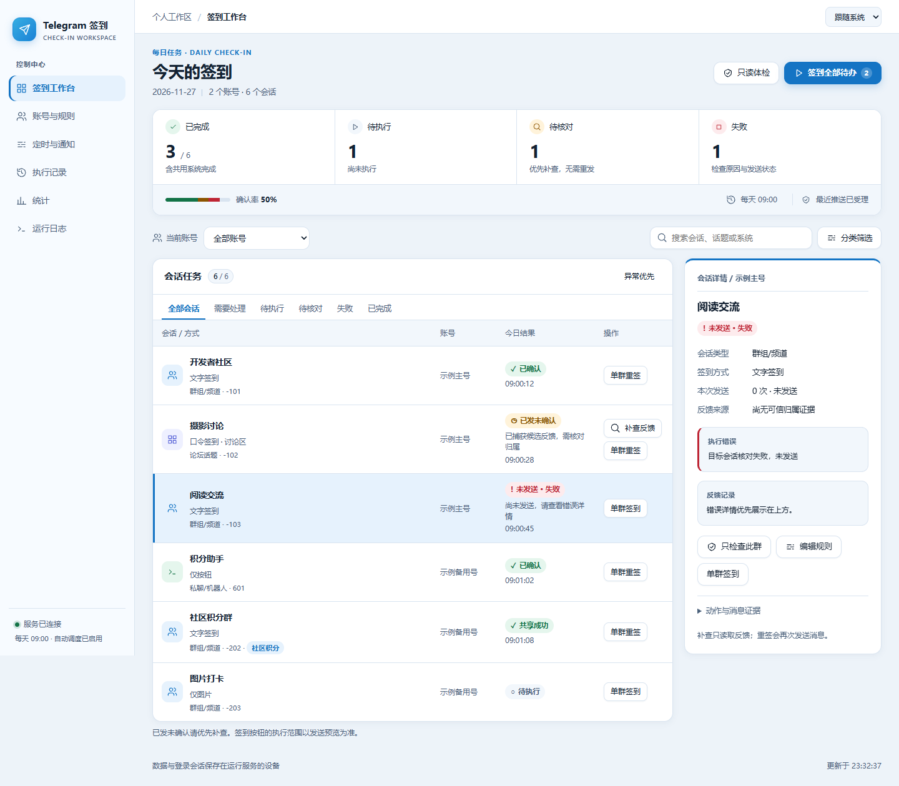
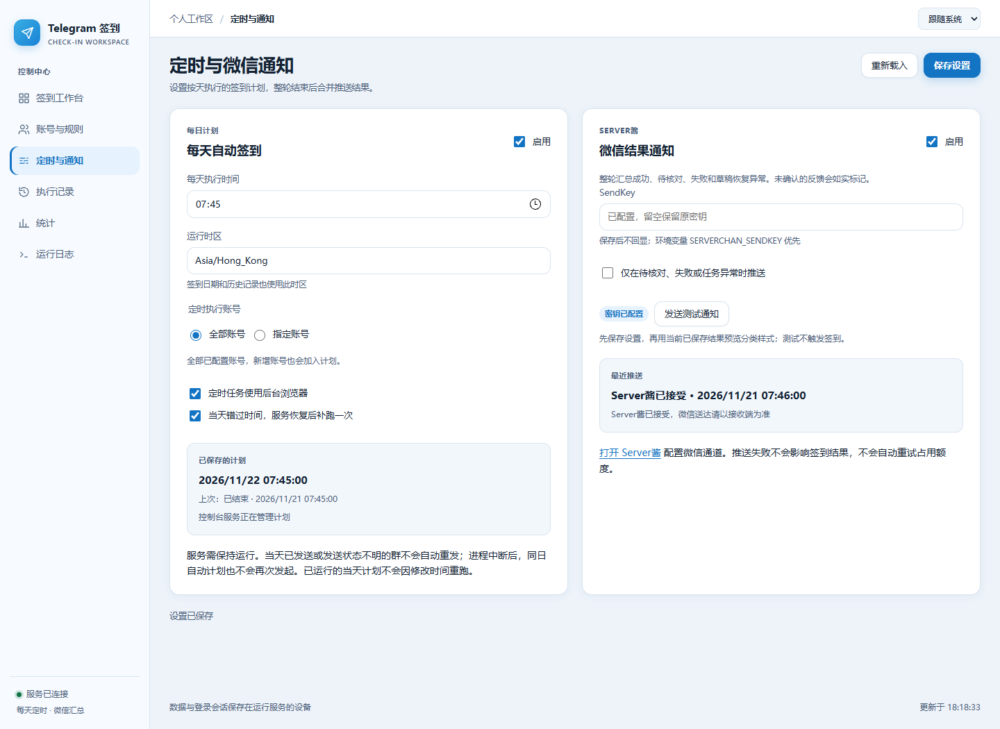
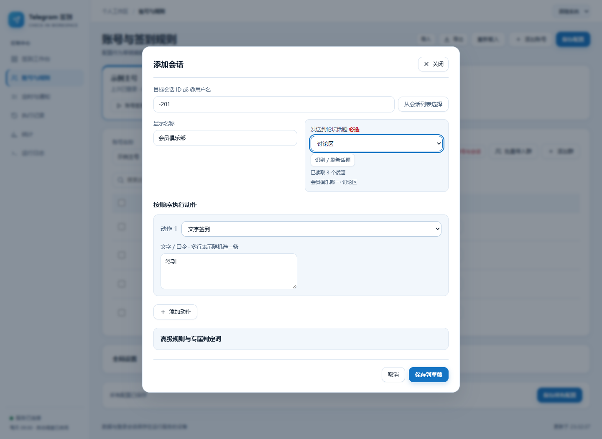

<div align="center">
  

  <h1>Telegram Checkin</h1>

  <p>
    <a href="README.md">简体中文</a> · <strong>English</strong>
  </p>

  <p><strong>A multi-account Telegram Web check-in workbench for desktop and Linux servers</strong></p>
  <p>No API ID or API Hash required — includes a local web console, daily scheduler, read-only evidence recheck, lossless draft recovery, and WeChat (ServerChan) summaries.</p>

  <p>
    <a href="#installation"><strong>Download v1.3.5</strong></a> ·
    <a href="#key-features">Key Features</a> ·
    <a href="#screenshots">Screenshots</a> ·
    <a href="#quick-start">Quick Start</a> ·
    <a href="#safety--verification">Safety</a> ·
    <a href="docs/CLOUD.md">Cloud Deployment</a> ·
    <a href="CHANGELOG.md">Changelog</a>
  </p>

  <p>
    <a href="https://github.com/ElmaTony/telegram-checkin/actions/workflows/build.yml"></a>
    
    
    <a href="LICENSE"></a>
  </p>

  <br>

  

  <p><sub>Anonymous sample data shown · Built-in Telegram Sky light &amp; night themes</sub></p>
</div>

---

## Key Features

| Feature | Description |
| --- | --- |
| **Multi-Account & Full Chat Coverage** | Supports standard groups, read-only channels, private bots, and **Forum Topics** with automatic topic detection and virtualized topic-list scrolling. |
| **Six Check-in Methods & Multi-Step Flows** | Supports text, command, button-only, command + multi-level buttons, image + text, image-only, chained actions, randomized messages, `{n}` / `X` numeric wildcards, and **shared check-in groups** with primary-first propagation. |
| **Evidence-Based Anti-Resend** | Monitors bot replies, modal popups, non-modal toasts, and inline button edits to distinguish **Success**, **Unconfirmed**, and **Failed**. Already-sent or uncertain targets use read-only recheck before any resend. |
| **Lossless Draft Preservation** | Backs up and clears existing Telegram drafts before sending, then restores them to the exact account, chat, and topic on completion, failure, or cancellation; keeps a local backup with a warning if safe restoration cannot be verified. |
| **Daily Scheduler & WeChat Summary** | Runs an independent daily schedule in any IANA timezone (with custom time picker, searchable 400+ IANA timezone picker, account scoping, headless execution, and same-day catch-up), sending a consolidated **ServerChan** summary when each round finishes. |
| **Modern Light & Night Workbench** | Built-in Telegram Sky light and night palette with run preview, live stage progress, date-grouped history, statistics, and runtime log viewer. |

---

## Screenshots

### Schedule & Notifications


<details>
<summary>Expand: Forum Topic Picker Dialog</summary>

<br>



</details>

---

## Installation

### Option 1: Standalone Packages (Recommended, No Python Required)

Download the archive for your platform from **[Latest Release](https://github.com/ElmaTony/telegram-checkin/releases/latest)** and keep the extracted directory intact (verify with the matching `.sha256` file):

| Platform & Architecture | Package |
| --- | --- |
| Windows x64 | `telegram-checkin-v*-windows-x64.zip` |
| macOS Apple Silicon | `telegram-checkin-v*-macos-arm64.tar.gz` |
| macOS Intel | `telegram-checkin-v*-macos-x64.tar.gz` |
| Linux x64 | `telegram-checkin-v*-linux-x64.tar.gz` |
| Linux ARM64 | `telegram-checkin-v*-linux-arm64.tar.gz` |

Install Chromium once, then launch the workbench:

```powershell
# Windows (PowerShell)
.\telegram-checkin.exe --install-browser
.\telegram-checkin.exe
```

```bash
# macOS / Linux
./telegram-checkin --install-browser
./telegram-checkin
```

Open **[http://127.0.0.1:8577](http://127.0.0.1:8577)** in your browser.

> [!NOTE]
> Network access to Telegram Web is required. On Linux, run `sudo ./telegram-checkin --install-browser-deps` if browser system libraries are missing. macOS packages are currently unsigned and unnotarized.

### Option 2: Run from Source (Python 3.11+)

```bash
git clone https://github.com/ElmaTony/telegram-checkin.git
cd telegram-checkin
```

```powershell
# Windows (PowerShell)
python -m venv .venv
.\.venv\Scripts\python.exe -m pip install -r requirements.lock.txt
.\.venv\Scripts\python.exe -m playwright install chromium
.\.venv\Scripts\python.exe app.py
```

```bash
# macOS / Linux
python3 -m venv .venv
.venv/bin/python -m pip install -r requirements.lock.txt
.venv/bin/python -m playwright install chromium
.venv/bin/python app.py
```

On Linux, use `playwright install --with-deps chromium` to install system browser libraries. On Windows, you can double-click `start_gui.bat` for daily launches.

### Common CLI Flags

| Flag | Description |
| --- | --- |
| *(none)* / `--gui` | Start the local Web UI and built-in scheduler (`http://127.0.0.1:8577`) |
| `--run` | Run check-ins immediately (combine with `--account <name>` for a single account) |
| `--schedule` | Run the daily scheduler in headless CLI mode without starting the Web UI |
| `--login <account>` | Open a visible browser window to scan and sign in to Telegram Web |
| `--doctor --browser` | Verify bundled assets, writable data directory, timezone database, and Chromium launch |
| `--notify-test` | Send a ServerChan test notification from saved results (no check-in triggered) |
| `--home <path>` | Override the persistent data directory (same as `CHECKIN_HOME`) |

---

## Quick Start

1. **Add & Sign In**: Open **Accounts & Rules (`账号与规则`)**, add an account, save, then click **Login (`登录`)** and scan the Telegram Web QR code.
2. **Configure Chats**: Pick target groups, channels, or bots from your Telegram chat list, configure check-in methods and keywords, and pick the target topic for forum groups.
3. **Run & Inspect**: Trigger all accounts, a single account, or a single chat from **Workbench (`签到工作台`)**; enable browser visibility if you want to watch the run live.
4. **Schedule & Notify**: Configure daily run time, IANA timezone, account scope, and your ServerChan `SendKey` under **Schedule & Notifications (`定时与通知`)**, then send a test notification.

> The daily schedule is disabled by default; keep either the Web UI or `--schedule` running once enabled.

---

## Safety & Verification

| Status | Meaning & Recommended Action |
| --- | --- |
| **Success** | Confirmed feedback attributed to this account (or propagated from a shared check-in group). |
| **Unconfirmed** | A send occurred, but evidence is insufficient; use **Read-Only Recheck** before resending. |
| **Failed** | Navigation, topic lookup, sending, or button interaction failed; inspect the details first. |

- **Lossless Draft Recovery**: Existing drafts are backed up and cleared before sending, and restored afterward on success, failure, or cancellation; if safe restoration cannot be verified, the local backup is preserved with an explicit alert.
- **Anti-Resend Protection**: Already-sent or uncertain chats are never blindly re-sent by the scheduler, and an interrupted scheduled run will not fire a second time on the same day.

### Data Directory & Upgrades

Source installs store data in the repository directory, while standalone packages store persistent data separately (override with `--home` or `CHECKIN_HOME`):

| OS | Default Data Directory |
| --- | --- |
| Windows | `%LOCALAPPDATA%\TelegramCheckin` |
| macOS | `~/Library/Application Support/TelegramCheckin` |
| Linux | `~/.local/share/telegram-checkin` (respects `XDG_DATA_HOME`) |

> [!IMPORTANT]
> Your data directory stores `config.yaml`, Telegram browser profiles (`data/`), `data/secrets.json` (SendKey), state, and history. Never upload it publicly, and always stop the app and back up before upgrading.

---

## Cloud Deployment

Supports long-running headless deployment on Ubuntu 22.04 / 24.04 (x64 & ARM64) with bundled systemd service templates in `deploy/`. After an initial QR login in a temporary visible desktop (X11 / local VNC), runs headless and can be accessed safely over an SSH tunnel (`ssh -L 8577:127.0.0.1:8577`). See **[docs/CLOUD.md](docs/CLOUD.md)** (Chinese) for the full checklist.

---

## Documentation

**[Configuration Reference](docs/CONFIGURATION.md)** (Chinese) · **[Cloud Deployment](docs/CLOUD.md)** (Chinese) · **[Changelog](CHANGELOG.md)** (Chinese) · **[MIT License](LICENSE)**
